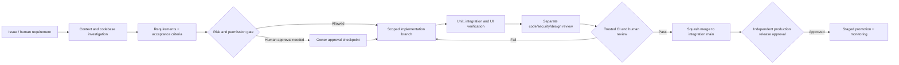

# PropertyGOJB — Agentic Repository & Engineering Blueprint

**Status:** Proposed architecture and migration plan — NOT implemented or approved  
**Date:** 17 October 2026  
**Target:** `JOSEPH990108/propertygojb` (not accessible at research time)  
**Reference:** `JOSEPH990108/propertygojb-v3`, branch `preprod`  
**Mission:** A modular, production-grade property platform with safe, portable agentic engineering workflows and a cinematic public experience.

> This is a planning artifact. It neither creates a repository nor modifies application code, CI settings, secrets, infrastructure, or production services. Respect the existing `PLAN_V1`, `PLAN_REVIEW`, `PLAN_V2`, and `PROPERTYGOJB_PLAN_V2_REVIEW` material; issue a targeted 2.1 reconciliation before executing overlapping work.

## 1. Verified current-state findings

The GitHub repository `propertygojb-v3` is public with default branch `main`; its `preprod` tree has 714 Git tree entries including 493 blobs, compared with 66 entries on `main`. The new `propertygojb` repository returned a 404 at inspection time. The 714 and 66 counts are tree entries, **not** feature, commit, or line-of-code counts.

`preprod` already contains:

- Three Next.js route surfaces: public/customer, agent, and admin.
- PostgreSQL/Drizzle schemas and migrations; Better Auth, four coarse roles; mobile OTP and related endpoints.
- Leads, appointments, customers, bookings, project management, media, payment/document workflow routes, and inbound WhatsApp webhook files.
- `AGENTS.md`, `.github/copilot-instructions.md`, path-specific instructions, a governed SDLC skill, CI workflow, CODEOWNERS, a JSON business-rule registry, and living architecture documentation.
- Nineteen `*.test.*` files found by path search, but no Playwright suite found in the inspected repository tree.

**Important:** Presence of routes or files does not prove business completeness, security, successful CI, or production deployment readiness. The older session context dated September 4 claims no committed CI/CODEOWNERS even though both now exist. This demonstrates that human-readable memory can lag behind actual source state. `package.json` names the package `propertygojb-clean`, which should be reconciled during migration, not blindly copied.

## 2. Architecture decision record ADR-001 — One repository, one modular monolith, three product surfaces

**Decision:** Keep **all three product surfaces in one repository**, initially with **one Next.js deployable**, one PostgreSQL system of record, and explicit per-domain module boundaries. Keep separate URL namespaces and per-surface visual identity. Do **not** prematurely create three Next.js apps or three separately deployed services.

Surfaces:

| Surface | Entry point | Purpose | Visual contract |
| --- | --- | --- | --- |
| Public/customer | `/`, `/projects`, `/account` | Discover projects, inquire, manage customer journey | Architectural/cinematic, premium but performant |
| Agent | `/agent` | Leads, follow-ups, appointments, bookings, customer tasks | Task-first, efficient, usable on mobile |
| Admin | `/admin` | Catalog, role/agent controls, inventory, CRM, reports, settings | Dense, readable, auditable operations |

Shared domains: identity, projects/catalog, inventory, CRM/leads, customers, bookings, documents, payments, messaging/integrations, audit/analytics. Share the **domain** and reusable primitives, not the entire UX.

Split to separately deployed applications only after observable requirements justify it: independent scaling/release cadences, security isolation, significantly different runtime or compliance boundaries, or build/dependency bottlenecks. Even after splitting deployments, **one monorepo** can remain appropriate. If a split occurs, use `apps/web`, `apps/agent`, `apps/admin`, plus narrowly defined packages such as `packages/contracts` and `packages/ui`; do not infer that a monorepo must contain multiple apps.

## 3. Proposed target directory layout

```text
propertygojb/
├── AGENTS.md                         # One authoritative cross-agent policy entry
├── README.md
├── package.json
├── package-lock.json
├── .node-version                     # Human-approved toolchain pin
├── .github/
│   ├── copilot-instructions.md      # Thin bridge to AGENTS.md
│   ├── instructions/
│   │   ├── public-ui.instructions.md
│   │   ├── internal-ui.instructions.md
│   │   ├── domain-security.instructions.md
│   │   └── database.instructions.md
│   ├── agents/
│   │   ├── architect.md
│   │   ├── implementer.md
│   │   ├── reviewer.md
│   │   ├── security-reviewer.md
│   │   └── design-reviewer.md
│   ├── prompts/
│   │   ├── plan-feature.prompt.md
│   │   ├── review-pr.prompt.md
│   │   └── handoff.prompt.md
│   ├── workflows/
│   │   ├── ci.yml
│   │   ├── security.yml
│   │   └── release.yml              # Add only after release-gate rehearsal
│   ├── CODEOWNERS
│   ├── pull_request_template.md
│   └── ISSUE_TEMPLATE/
├── .agents/
│   └── skills/
│       ├── repo-onboarding/SKILL.md
│       ├── feature-planning/SKILL.md
│       ├── nextjs-domain-implementation/SKILL.md
│       ├── ui-cinematic/SKILL.md
│       ├── ui-operations/SKILL.md
│       ├── code-review/SKILL.md
│       ├── threat-review/SKILL.md
│       ├── migration-safety/SKILL.md
│       ├── test-engineering/SKILL.md
│       └── session-handoff/SKILL.md
├── docs/
│   ├── architecture/
│   │   ├── SYSTEM_OVERVIEW.md
│   │   ├── BOUNDED_CONTEXTS.md
│   │   └── adr/ADR-0001-modular-monolith.md
│   ├── product/
│   │   ├── FEATURE_REGISTRY.md
│   │   └── WORKFLOWS.md
│   ├── engineering/
│   │   ├── SDLC.md
│   │   ├── SECURITY_BOUNDARIES.md
│   │   ├── REVIEW_POLICY.md
│   │   ├── TEST_STRATEGY.md
│   │   ├── RELEASE_RUNBOOK.md
│   │   ├── MIGRATION_LEDGER.md
│   │   └── HANDOFF.md
│   ├── design/
│   │   ├── DESIGN_SYSTEM.md
│   │   ├── PUBLIC_CINEMATIC_DIRECTION.md
│   │   └── INTERNAL_UX.md
│   ├── sdlc/
│   │   ├── business-rules.json
│   │   └── SESSION_CONTEXT.md
│   └── work-items/
├── scripts/
│   └── ci/
├── src/
│   ├── app/
│   │   ├── (public)/
│   │   ├── (auth)/
│   │   ├── (internal)/agent/
│   │   ├── (internal)/admin/
│   │   └── api/
│   ├── modules/
│   │   ├── identity/
│   │   ├── catalog/
│   │   ├── inventory/
│   │   ├── crm/
│   │   ├── bookings/
│   │   ├── documents/
│   │   ├── payments/
│   │   └── communications/
│   ├── components/
│   │   ├── ui/                    # Stable accessible primitives
│   │   ├── public/
│   │   ├── agent/
│   │   └── admin/
│   ├── db/
│   ├── config/
│   └── lib/
├── drizzle/
├── tests/
│   ├── integration/
│   ├── e2e/
│   └── visual/
└── public/
```

**Structure is directional, not permission to scaffold empty folders.** Ratify a module layout after implementing one real vertical slice. For example, a `src/modules/bookings/` feature may include `domain/`, `application/`, `infrastructure/`, and `presentation/` **only when needed**. Avoid a generic repository/service interface for every table and avoid reorganizing all stable code in one PR.

Recommended dependency direction: `app route -> application command/query -> domain policy -> repository/adapter -> DB/provider`; UI receives validated DTOs. Domain code must never import Next.js route files, UI components, or concrete providers. All protected mutations enforce user/role/ownership at their server boundary, regardless of route layout.

## 4. Git and PR working agreement

**Branching:** Trunk-based development with `main` as sole integration trunk and short-lived topic branches. Do not recreate persistent `develop`, `preprod`, `staging1`, or `staging2` branches simply because they exist in v3. Environment and branch are separate concepts; Vercel preview/staging can be managed without a permanent development branch where platform controls permit.

**Branch format:** `<type>/<issue>-<slug>` e.g. `feat/pg-142-lead-assignment`, `fix/pg-153-booking-idempotency`, `design/pg-170-cinematic-hero`, `chore/pg-174-ci-hardening`.

**Conventional Commits:** `<type>(<scope>): <imperative summary>`, lowercase type, concise subject, optional explanatory body and issue reference. Allowed examples:

```text
feat(crm): add guarded lead assignment
fix(bookings): prevent duplicate unit reservations
design(public): refine cinematic hero transitions
test(auth): cover cross-user access denial
refactor(catalog): isolate project publication policy
chore(ci): harden required quality checks
docs(architecture): document booking concurrency invariants
```

Use scopes such as `public`, `agent`, `admin`, `auth`, `crm`, `catalog`, `inventory`, `bookings`, `payments`, `documents`, `db`, `ci`, `security`. Automated enforcement should check the **squash title** as well as local commits if squash merging is enabled; avoid a complex homegrown parser without tests. A breaking API change uses `!` or a `BREAKING CHANGE:` footer.

**PR titles:** identical conventional format. Include issue reference in the body (e.g., `Closes #142`) so PR titles remain concise. Example: `feat(crm): add guarded lead assignment`.

**PR body:** Why, user-visible change, non-goals, affected surfaces/domains, risk class, linked requirement IDs, screenshots (if UI), tests and commands (pass/fail/not run), auth/ownership/integrity implications, migration/deployment effect, rollback, reviewer conclusion, and updated documentation. Use draft PRs for incomplete work and normal PRs only when scope and evidence are ready.

**Merge:** Squash after passing checks and accountable review. Never let an agent independently approve its own work, merge to protected branches, or promote production. A different AI reviewer is useful but does not substitute for an independent human when human separation of duties is required.

**Repository settings:** Protect `main`; disallow force pushes/deletions; require PRs and specific trusted CI status; require conversation resolution; use CODEOWNERS for protected paths; prevent bypasses as the plan/permissions allow. Confirm actual GitHub account plan and private/public repo support before declaring protection enforceable. Start with one unconditionally completed `quality-gate` status that fails closed on failed/cancelled critical prerequisites. Add more rules only after testing actual failure scenarios.

## 5. Fully agentic but risk-governed SDLC



**R0** read-only/research, **R1** bounded low-risk implementation in isolated branch, **R2** reversible guarded work with recorded scope and automated review, **R3** high-risk domains require explicit owner plan approval before source edits and extra validation, **R4** restricted operational activity (e.g., secrets, production/destructive changes, privilege decisions, customer messages) remains human-executed. Reevaluate risk if changed files/scope grow. Changes in `.github/**`, `AGENTS.md`, `.agents/**`, governance registries, package scripts, and delivery controls are sensitive control-plane changes even if described as “docs only.”

Custom agent roles are **responsibilities**, not independent legal or human identities:

| Agent | Inputs | Output | Write privileges |
| --- | --- | --- | --- |
| Architect | Issue, ADRs, source | Scope, design, risks, migration | Planning only by default |
| Implementer | Approved plan, interfaces, constraints | Minimal code + tests | Isolated branch only |
| Test engineer | ACs and changed code | Reproducible verification | Test files on bounded branch |
| Code reviewer | Git diff + policy | Findings by severity and exact lines | Read-only; no PR self-approval |
| Security reviewer | Auth, dataflow, threat scenarios | Risks, denied-path tests | Read-only |
| Design reviewer | Tokens, routes, screenshots | Visual/a11y/performance findings | Read-only |
| Handoff agent | Git state, check results | Concise durable checkpoint | Scoped docs only |

Copilot custom agents, prompt files, skills and hooks are **different tools**. `.github/agents/*.md` defines specialist personas; `.agents/skills/*/SKILL.md` provides reusable on-demand procedures; `.github/instructions/*.instructions.md` scopes policy to paths; `AGENTS.md` is the common root context; `.github/copilot-instructions.md` is a thin compatibility bridge. Skills should not duplicate dozens of pages of hard-coded instructions, and external skills require source/license/revision review before installation.

**Trusted policy boundary:** A candidate PR must never certify itself merely by editing the same risk classifier, quality configuration or CI workflow used to evaluate the PR. GitHub-enforced branch rules and trusted base-owned enforcement are different from advisory instructions run against untrusted PR code. Test this with intentionally adversarial PRs. Do not treat a PR comment containing a commit SHA as unforgeable AI review evidence. Do not rely on skipped jobs as proof that prerequisite checks succeeded.

## 6. Four-tier durable engineering memory

**M0 — Source of truth:** source code, database migrations, tests, installed API contracts. Never rewrite historical truth through prose.

**M1 — Architecture & policy:** approved ADRs, active and human-approved business rules, security boundaries. Machine-readable rules must have IDs, owners, evidence, enforcement status, and periodic review date.

**M2 — Product capability ledger:** `FEATURE_REGISTRY.md`, one entry per capability: `implemented`, `partial`, `planned`, `blocked`, `deprecated`; route/API/schema owners, evidence path, tests, security constraints, related ADR, last verified commit/date. This is a navigational index, not proof on its own.

**M3 — Session/work handoff:** `HANDOFF.md`, issue, PR and work-item notes: base and head SHA, worktree status, intent, files changed, results actually run, known risks, unresolved decisions, next bounded action. A fresh agent must inspect git and verify claims; never blindly trust old context.

Separate **decision memory** from **episodic chat history**. Do not dump entire chats into the repository or let agents silently activate inferred business rules. Store redacted, synthetic examples only. Preserve the old repo and its Git history for traceability rather than dragging all historical scratch work into new root docs.

Feature registry example:

```yaml
id: PG-FEAT-BOOKINGS-001
name: Unit booking creation
surface: [agent, admin]
domain: bookings
status: partial
source_ref: propertygojb-v3@preprod
implemented_in_target: false
security: [role-authorization, ownership, idempotency, inventory-lock]
proof: [tests/integration/bookings/create.test.ts]
reviewed_at: null
next_action: migration audit and booking-concurrency ADR
```

## 7. Design direction — Architectural cinema, not an animated template

**Public:** editorial composition with realistic Johor property media; cinematic, generous visual framing; clear architectural geometry, calm ivory/charcoal/champagne-bronze foundation, strong typographic hierarchy, carefully composed image crops, subtle film-inspired transitions, restrained gloss and glass. Do not fabricate building appearance, availability or project claims. Maintain precise performance and SEO budgets. Use multiple layout rhythms instead of the same AI-generated centered hero + feature-card grid.

**Agent:** compact task-oriented navigation, status clarity, one high-priority action per workspace, ergonomic filter/table/mobile cards, fast loading/error recovery. **Admin:** denser data, strong information hierarchy, consistent forms and audits. Public artistic styling must not reduce operational readability.

Implement tokens at the theme/surface boundary (`data-ui="public|agent|admin"` or a tested equivalent), with one accessible component primitive library where behavior is shared. Avoid global style changes that inadvertently restyle all three portals. Motion for React is already a dependency, so prefer its built-in transitions; consider GSAP only after establishing a justified interaction need. Honor reduced-motion and keyboard accessibility, maintain actual page speed and content accessibility.

Suggested design review outputs: mobile/desktop screenshots; image/video fallbacks; dark/light behavior if supported; loading/empty/error/success states; axe/keyboard checks; manual reduced-motion; measured Core Web Vitals. Any visual pixel threshold is an experimental review signal, not proof of design correctness.

## 8. Selected open-source skills to audit (not automatically install)

| Tool / source | Why | Recommended use |
| --- | --- | --- |
| [Agent Skills specification](https://github.com/agentskills/agentskills) | Portable `SKILL.md` convention | Foundation |
| [Vercel agent skills](https://github.com/vercel-labs/agent-skills) | `react-best-practices` and `web-design-guidelines` | Adopt after scope/content review |
| [UI/UX Pro Max](https://github.com/nextlevelbuilder/ui-ux-pro-max-skill) | Design-system research/reference | Ideation only; your tokens win |
| [Taste Skill](https://github.com/jeettrench/taste-skill) | Anti-template editorial frontend direction | Public pages only |
| [Motion documentation](https://motion.dev/docs/react-accessibility) | Motion, reduced-motion implementation | Runtime/quality reference |
| [Framer Motion skills](https://github.com/C-Jeril/framer-motion-skills) | Supplemental animation knowledge | Optional; verify `motion` package API compatibility |

Avoid bulk-installing third-party skill packages. Pin reviewed versions, inspect bundled scripts, permissions and outbound URLs, preserve license obligations, and compare generated output against **your** design tokens and security rules. Agent skills are guidance, not trusted executable policy by default.

## 9. CI and testing strategy

**PR required gate:** lockfile install, governance/static checks, formatting, lint, TypeScript, unit tests, isolated-Postgres migration, minimal integration suite, production build. Make required statuses reliable even on docs-only changes. Add unit/contract tests for role and ownership denial, idempotency and replay, booking concurrency, payment audit, document access, webhook signatures and deduplication. Add Playwright E2E for one public search/enquiry path, agent lead flow, and admin content-publishing path as migration reaches each vertical slice.

**Security:** least-privilege `GITHUB_TOKEN`, review action supply chain and pin actions to immutable revisions or workflow dependency lockfiles where available; never run PR head code with privileged `pull_request_target` secrets; enable applicable Dependabot/dependency review and CodeQL; redact production data from logs and model prompts. Separate protected base-trusted policy evaluation from untrusted PR code execution.

**Quality baseline:** record measured existing failures as failures; do not claim CI passed because a Markdown policy exists. Triage dependency advisories with severity, exposure, owner and time-limited exception, rather than using unreviewed `npm audit fix`.

## 10. Production release model — resolve BEFORE attaching Vercel

**Risk:** Vercel normally builds/releases automatically from the configured production branch, frequently `main`. A policy sentence that “merge is not release” is false unless hosting really enforces that separation.

**Recommended pattern:** Keep `main` integration-only; configure Vercel staged production with automatic domain assignment disabled (or use a separately gated release promotion mechanism proven available for the chosen account). Associate every release with an immutable commit SHA, checks, human owner, required independent high-risk approval, database compatibility, smoke tests, and rollback plan. Demonstrate denial of a release lacking approval. Preview deployments must use synthetic or isolated data. Never expose a preview that can mutate production customer data by accident.

Two-human high-risk release policy has an operational cost for a solo maintainer: name the qualified external reviewer or accept an explicit fail-closed release blocker. Do not equate an AI code review with another independent human. Decisions about exact exceptions/compensating controls require human governance signoff.

## 11. Incremental migration plan and exit gates

| Phase | Deliverable | Gate to proceed |
| --- | --- | --- |
| A — Reconcile blueprint | Targeted PLAN_V2.1 corrections, architecture ADR, risk/release decisions | Owner approves disputed policy choices |
| 0 — Local foundation | Minimal reproducible Next.js/TS toolchain, docs, clean baseline | `npm ci`, lint, types, test, build with actual evidence; preserve old repo |
| 1A — Portable agents | AGENTS bridge, 2–3 essential skills, agents, handoff, governance tests | Fresh Copilot session reproduces source understanding; injection/adversarial checks |
| 1B — Remote Git governance | Create/access repo, PR templates, trusted required gate, CODEOWNERS | Verified branch protection and failure cases, with real plan/account permissions |
| 1C — Hosting release spike | Staged Vercel integration, isolated preview, no auto release | Rehearsed production lock, approval, audit and rollback |
| 2 — Public thin slice | Layout, SEO, catalog discovery, enquiry, cinematic design tokens | Real screenshots, a11y, E2E, performance, actual data truth |
| 3 — Internal vertical slices | Staff auth/RBAC, CRM, inventory/booking, documents/payments incrementally | Domain ADRs, denied-path + concurrency tests, traceable migration |
| 4 — Integrations and operations | SMS, WhatsApp, storage scanning, jobs, monitoring | Provider staging tests, budget, retry/kill switch, incident runbooks |
| 5 — Production readiness | Security, operational, data and release audit | Explicit accountable human signoff and staged release evidence |

**Migration method per slice:** discover old source -> inventory and classify feature -> document invariant and ownership -> identify data/schema and external dependencies -> transplant/refactor minimal code -> tests with synthetic fixtures -> independent review -> preview with isolated data -> record in migration ledger. Do not `git clone` old main as the foundation, and do not copy every old file or migration without a clear data continuity decision. Maintain old repo read-only after eventual replacement, with history intact. An initial target app is not a replacement production system merely because it builds.

Specific ADRs that must be settled before their slice: identity/roles, catalog model (`project` vs `unit` vs `listing`), booking state machine and global DB lock order, payments verification and financial audit, document storage/scan/retention, SMS/WhatsApp consents and messaging, Malaysia locale/time/currency, customer PII handling, deployment/data migration.

## 12. Hard checkpoints, risks, and acceptance criteria

**Architecture complete when:** a new agent can understand all three surfaces from source; architectural import boundaries are testable; the first vertical slice fits naturally without scaffolding explosion.

**Agentic governance complete when:** a fresh model/harness follows the correct instruction hierarchy; work items contain acceptance criteria; tool permissions match operationally tested sandbox restrictions; independent review is real and accurately represented; adversarial PRs cannot self-weaken policy; no automated merge/secret changes/production sends.

**Memory complete when:** feature ledger lines link to verified commits/tests; session handoffs survive fresh-chat restarts; obsolete summaries are corrected or deprecated; an inferred rule cannot be silently activated.

**Release complete when:** merge is demonstrably separated from production promotion, including a failing high-risk missing-reviewer test, and rollback plus DB compatibility are rehearsed.

## 13. Immediate action — proposal only

Create **no** new implementation repo changes until owner approves the revised blueprint and scope. First reconcile `PLAN_V2` against `PROPERTYGOJB_PLAN_V2_REVIEW.md` (at minimum review issues V2-01 through V2-06) and explicitly decide the enforceable release model, independent human review path, and Phase 0 authorization. Then do local foundation work, followed by remote governance and sliced feature migration. Avoid an unbounded “install all skills” operation.

## References verified during research

- GitHub customization: https://docs.github.com/en/copilot/reference/customization-cheat-sheet
- GitHub repository instructions: https://docs.github.com/en/copilot/how-tos/copilot-on-github/customize-copilot/add-custom-instructions/add-repository-instructions
- GitHub protected branches: https://docs.github.com/en/repositories/configuring-branches-and-merges-in-your-repository/managing-protected-branches/about-protected-branches
- GitHub Actions secure use: https://docs.github.com/en/actions/reference/security/secure-use
- Conventional Commits: https://www.conventionalcommits.org/en/v1.0.0/
- DORA trunk based: https://dora.dev/capabilities/trunk-based-development/
- Next.js route groups: https://nextjs.org/docs/app/api-reference/file-conventions/route-groups
- Vercel deployment promotion: https://vercel.com/docs/deployments/promoting-a-deployment
- Agent Skills specification: https://github.com/agentskills/agentskills
- Vercel agent skills: https://github.com/vercel-labs/agent-skills
- NIST SSDF: https://csrc.nist.gov/pubs/sp/800/218/final
- OWASP agentic risk: https://genai.owasp.org/resource/owasp-top-10-for-agentic-applications-for-2026/
