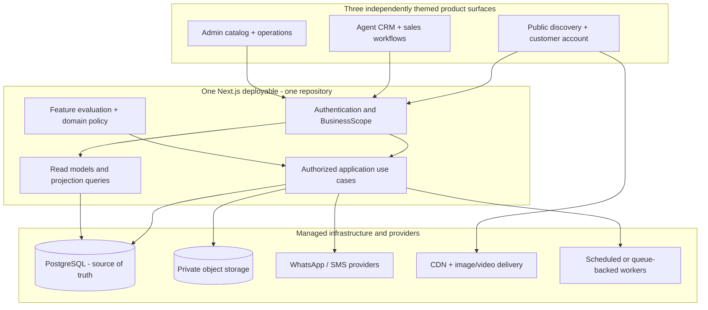
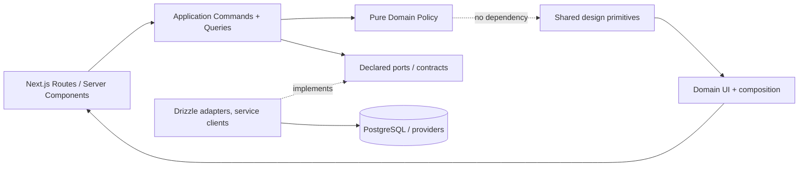
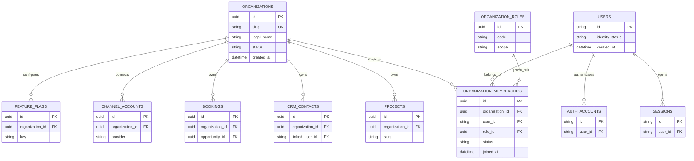
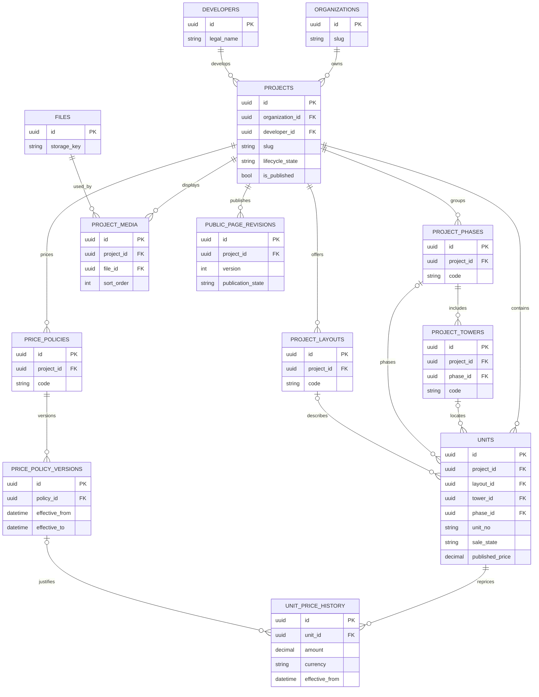
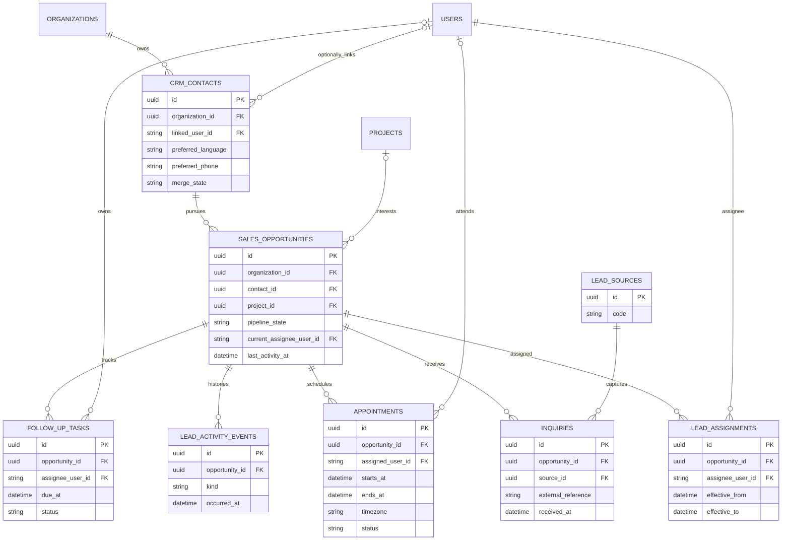
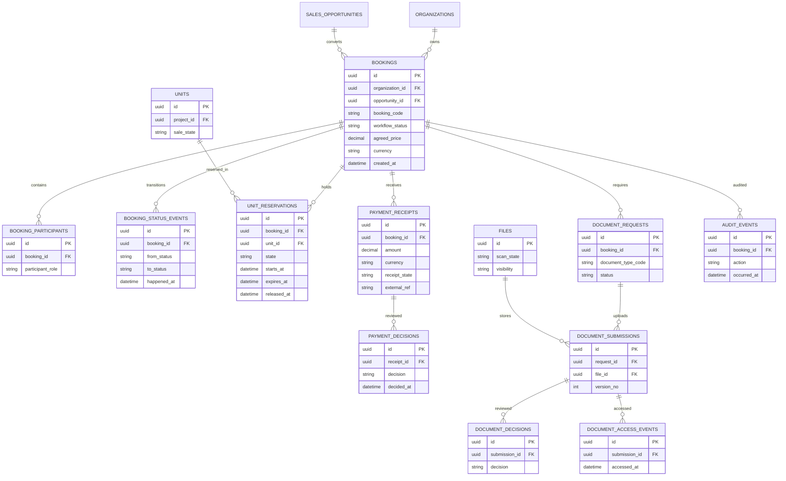
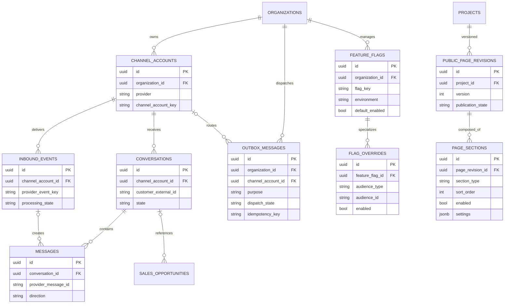

# PropertyGOJB — Target Architecture, ERD and Single-Company → SaaS Evolution Plan (V1)

**Status:** Read-only planning proposal; **NOT** approved implementation design  
**Prepared:** 17 October 2026  
**Source repository:** [`JOSEPH990108/propertygojb-v3`, `preprod`](https://github.com/JOSEPH990108/propertygojb-v3/tree/preprod)  
**Source tree SHA:** `4d007e1718bbf628ab10c6873239c338835b706c` (rechecked this session)  
**Target repository:** `propertygojb` (not created or modified by this planning activity)  
**Chosen product model:** One operating company and three surfaces at launch; deliberately staged migration to independent agency tenants.  
**Evidence:** GitHub source/tree and existing planning reviews. No runtime database, customer records, deployed environment, logs, running tests, or production configuration was accessed. **ERDs tagged TARGET describe proposals, not deployed tables.**

---

## 0. Architecture decision and non-goals

**Decision AD-01:** Begin as a **single-deployable modular monolith**: Next.js App Router, React, TypeScript, PostgreSQL and Drizzle ORM; Better Auth retained pending an authentication ADR. Product surfaces: public/customer, agent, admin. One operational company at launch. Domain boundaries remain explicit and prepare an eventual SaaS migration without exposing multi-agency UX, agency billing, tenant switching or cross-organization collaboration now.

**Decision AD-02:** Establish a **minimal organization identity seam** as the new repository is built, rather than retrofitting all business data only after growth. Establish one `organizations` row and membership/role design under the identity migration, with an internal `BusinessScope`/`ActorContext` that always resolves to the singleton launch organization. Introduce `organization_id` selectively to owned business roots, and add it to child tables only where required for safe FK composition, tenant-scoped querying, efficient filtering, or future RLS. Initial operations remain single-company and use no client-supplied organization switch. The exact schema migration is subject to identity/authorization ADR, a staging-data audit, and safe incremental rollout.

**Decision AD-03:** `users` are **global identities**, while agent/admin roles are conceptually **membership-specific**. Keep the existing global `users.role_id` as a compatibility detail until membership authorization is implemented, validated and switched; do not simultaneously interpret both sources as authoritative. Platform-wide support administrators (if introduced) are a *different* identity/privilege policy from tenant administrators.

**Decision AD-04:** Agency-owned catalog and inventory are the **first SaaS model**. Multiple companies do not automatically share reservation authority over the same unit. Cross-agency/shared developer catalogs, resales co-brokering and supplier-managed global inventory require a separate later business ADR.

**Decision AD-05:** Reuse present capabilities, not the present monolithic route handlers. Preserve existing route URLs as needed while extracting domain commands, enforcing invariants and regression-testing each vertical slice.

**Explicit non-goals for foundation:** multiple deployed services; separate per-agency databases; Kubernetes; generic global event bus; billing/subscriptions; an arbitrary CMS page builder; unrestricted agent/AI access to production data; data schema redesign for visual styling; a forced full rewrite of all 73 tables.

### Evidence legend

- **CURRENT / sourced:** a real declaration or code path exists in inspected `preprod`.
- **CURRENT / candidate gap:** source indicates a plausible correctness issue; test the actual behavior before claiming a production incident.
- **TARGET / proposed:** a candidate entity, constraint, module or contract; not implemented.
- **GATE:** no implementation until the named ADR and acceptance checks pass.

---

## 1. Current-state technical inventory: 73 declared tables

The inspected branch contains 18 files under `src/db/schema/`, with **73 `pgTable(...)` declarations** spread across 14 table-defining files. `relations.ts` (~938 lines), `enums.ts`, `base.ts` and `index.ts` define ORM relations/helpers and add no physical tables. Table declaration is not proof of an applied production migration.

| Area | Current physical table declarations | Current observations |
| --- | --- | --- |
| Identity (5) | `roles`, `users`, `session`, `account`, `verification` | Better Auth-compatible session/account models, user-global `role_id`, non-null `users.email`, phone fields |
| OTP (1) | `otp_challenges` | Purpose/phone index, partial uniqueness for open challenges |
| Catalog (10) | `developers`, `projects`, `project_phases`, `project_towers`, `project_availability_plans`, `project_layouts`, `project_media`, `project_nearby_places`, `project_amenities`, `project_tags` | Hierarchical property master data; media and curated page content |
| Inventory (2) | `units`, `pricing_snapshots` | Unit-level status and prices, snapshot pricing |
| CRM (6) | `lead_sources`, `leads`, `inquiries`, `lead_assignments`, `lead_activities`, `lead_status_history` | Lead contacts/opportunities combined; appointments and follow-ups encoded as activities |
| Booking (6) | `bookings`, `booking_units`, `booking_participants`, `booking_status_history`, `booking_payments`, `booking_activities` | `booking_units` has unique `booking_id` (one unit per booking), booking state and payment status intertwined |
| Documents (5) | `document_types`, `document_requests`, `document_submissions`, `document_verification_logs`, `document_access_logs` | Files represented separately; verification/activity/audit schema exists |
| Storage (1) | `files` | Provider metadata, scan status, private scopes |
| Geography (3) | `states`, `regions`, `areas` | Shared location taxonomy |
| Lookup (17) | `property_categories`, `property_types`, `tenure_types`, `title_types`, `lot_types`, `unit_positions`, `unit_views`, `unit_facings`, `project_statuses`, `construction_statuses`, `booking_statuses`, `appointment_statuses`, `buyer_types`, `media_types`, `layout_types`, `amenities`, `tags` | Static/reference definitions and curated classifications |
| Governance (4) | `permission_groups`, `permissions`, `role_permissions`, `user_permissions` | Detailed grants exist in schema, runtime enforcement requires proof |
| Audit/approval (3) | `audit_logs`, `auth_audit_logs`, `admin_action_approvals` | Mutation audit, login audit, two-person approval candidates |
| Settings (3) | `system_settings`, `feature_flags`, `feature_flag_overrides` | Environment-scoped config + role/user overrides |
| WhatsApp (7) | `whatsapp_agent_queues`, `whatsapp_agent_queue_members`, `whatsapp_assignment_rules`, `whatsapp_conversations`, `whatsapp_messages`, `whatsapp_webhook_events`, `whatsapp_delivery_events` | Inbound schema, routing, dedupe and delivery tracking |
| **Total** | **73** | **Source-level schema only; live DDL not inspected** |

**Current source links:** [schema directory](https://github.com/JOSEPH990108/propertygojb-v3/tree/preprod/src/db/schema), [booking creation](https://github.com/JOSEPH990108/propertygojb-v3/blob/preprod/src/app/api/internal/leads/booking/route.ts), [agent claim](https://github.com/JOSEPH990108/propertygojb-v3/blob/preprod/src/app/api/agent/leads/claim/route.ts), [appointment route](https://github.com/JOSEPH990108/propertygojb-v3/blob/preprod/src/app/api/internal/leads/appointment/route.ts), [feature flag model](https://github.com/JOSEPH990108/propertygojb-v3/blob/preprod/src/db/schema/settings-flags.ts).

### Important clarifications versus older audit

- `AppReveal` **does** pass `className` to `motion.div` in the currently inspected `src/components/common/app-reveal.tsx`. A previous report calling this missing was inaccurate. No correction is required on that specific point.
- Existing appointments **do not currently have their own table**. The API persists `VIEWING_APPOINTMENT` in `lead_activities`, with schedule and status in `due_at` and `metadata.appointmentStatus`. Follow-ups similarly use `CUSTOMER_FOLLOW_UP` activity records. This is a documented modeling improvement candidate, not evidence that appointments do not work.
- Current global uniqueness: `projects.slug`; active `leads.primary_phone_normalized`; open WhatsApp conversations by `(provider, normalized_phone)`; booking code; unit number `(project_id, unit_no)`. SaaS rollout must explicitly re-evaluate these constraints.
- `users.email` is `.notNull()` even though the product focuses on mobile registration. A phone-only account design must audit how the existing identity provider handles email, uniqueness, verification and migrations; do not assume that a dummy email is acceptable.

### Main correctness gaps to verify before migration

| Severity | Current code evidence | Failure mode requiring negative-path test |
| --- | --- | --- |
| Critical | Booking creation reads unit availability and checks existing `booking_units` without an independent database-enforced active-unit uniqueness condition | Two sessions can both observe available inventory and create competing holds; verify using real DB concurrency harness |
| Critical | Lead claim route updates assignment rows, `leads`, and activities in separate statements without an enclosing transaction | Concurrent claim and partial-error inconsistency |
| High | Payment mutation derives new paid amount from a balance read prior to `db.transaction` | Concurrent updates/lost balances; `RECEIVED` and `VERIFIED` must not be counted indiscriminately |
| High | Status transition map and business rules implemented inside large Next.js route | Multiple routes may apply incompatible transition policies |
| High | Appointment state lives in JSON metadata of a generic activity | Weak database constraints, difficult schedule indexes/state reporting |
| High | `unit.project_id` and its `layout_id`/`tower_id`/`phase_id` each refer to individually valid rows | Cross-project parent mismatch remains possible unless query services validate or composite FK is added |
| High | Upload endpoint writes sensitive document bytes under `.local-uploads`, then commits DB file/submission rows | Filesystem not durable across ephemeral deployments, no verified malware quarantine/scan/compensation flow |
| High | `writeAuditLog` imports global `db` | An audit write can be outside the business transaction unless transaction-aware call path is designed |
| Medium | `relations.ts` is one large cross-domain definition file | Harder maintainability; migration should preserve explicit relational exports |
| Medium | Public page assembles view-model details inline, fixed sections | Harder to reuse layout presets and safely toggle sections |

---

## 2. System context, ownership and deployment



**Top-level rules:**

1. A route/page performs authentication, input validation and composition; business mutation lives in an application command.
2. Public, agent and admin surfaces do not write directly to the same tables with independently invented rules.
3. The backend resolves `BusinessScope` from server-side identity, verified domain routing or trusted provider channel mapping, **never** from a client-provided `organizationId` alone.
4. Business state mutations are transactionally consistent; required audit and outbox records commit atomically with the authoritative write.
5. Outbound integrations use an outbox/worker when retries and delivery semantics require it, with idempotency and human approval for high-risk sends.
6. AuthZ and configuration remain distinct: a hidden component, disabled flag or selected theme cannot grant or bypass privileges.
7. Current launch has a single organization; public hostnames remain the current single-company brand until a domain-routing ADR explicitly enables multi-org SaaS.

---

## 3. Bounded contexts and directed dependencies

| Module | Owns authoritative behavior | Primary reads/calls | Must NOT own |
| --- | --- | --- | --- |
| `identity` | Auth identities, sessions, organization membership, access context | Better Auth adapter, approved role/permission policy | Lead assignment or business record ownership directly |
| `catalog` | Developers, project/phase/tower/layout master data, approved publishing metadata | Geography, files via media reference | Unit holds, sales payments |
| `inventory` | Physical units, status projection, accepted price/availability policies, reservation primitive | Catalog identity; booking orchestration through a narrow command | Workflow approval, payment verification |
| `crm` | Contact records, opportunity/lead qualification, inquiry history, assignment, activity history | Identity of agent, catalog ID | Units reservation semantics |
| `scheduling` | Appointments and follow-up tasks; dates, ownership, reminders, statuses | CRM contacts/opportunities, agent identity | Generic mutable JSON appointment state |
| `bookings` | Booking application workflow, participants, lifecycle and guarded commands | Inventory reservation port, CRM reference, payment/doc readiness policies | Direct provider SDK access |
| `payments` | Captures, verified amount, refunds, source references, payment event history | Booking amount due + actor policy | Assign inventory availability independently |
| `documents` | Requests, versions, scan outcomes, human verification, access audit | Booking/participant references, media/storage adapters | Public asset management |
| `communications` | Channel accounts, conversations, messages, inbound events, routing, consent gates | CRM link and trusted channel ownership | Direct mutation of booking approvals |
| `publishing` | Versioned page definitions and section config | Catalog approved view models, files | Arbitrary executable templates or authorization |
| `governance` | Flags/settings/audit/approval workflows | Identity and event metadata | Hidden business-policy overrides |
| `platform` | DB, observability, cache, jobs, provider adapters, env/config | Shared infrastructure only | Business-specific state machines |

**Dependency rule:** modules import another module's **public application interface**, never its private repository or schema helper. Cross-domain orchestration is one named application use case (e.g., `bookings.create`) with approved dependencies. Do not introduce distributed transactions for this single-DB monolith.



**Recommended per-module layout (grow only when actual code exists):**

```text
src/modules/<domain>/
  domain/             # Pure state, invariants, value objects, errors
  application/        # Commands / queries, actor checks, idempotency, tx orchestration
  infrastructure/     # Drizzle and provider adapters hidden behind contracts
  ui/                 # Typed view model consumers, domain-specific components
  index.ts             # Explicit public import surface
```

Keep `src/db/schema/*` as a single authoritative table catalog and split `relations.ts` across domain relation files if the current Drizzle version reliably supports exporting them together. Avoid multiple competing schema definitions.

---

## 4. ERD A — identity and company ownership (TARGET, not current)



**Notation:** UUID in diagrams is the desired logical identifier type for *new* entities only. Existing `text` IDs (including Better Auth user IDs) remain unchanged until separately assessed. Some FK targets/attributes are omitted for readability. `FEATURE_FLAGS.organization_id` can be nullable for platform defaults; a precise global/tenant override scheme needs ADR-CFG. The diagram's `UK` suffix is descriptive and does not mean that current tables have this constraint.

### Ownership and auth rules

- **At launch:** one seeded `organizations` record, one internal `BusinessScope`, no tenant selector. An authenticated user's role is validated under the single company; existing roles still operate until membership migration is complete.
- **At SaaS:** `users` and auth accounts stay global; `(organization_id, user_id)` membership uniqueness and per-organization role/permissions become authoritative. A user may hold independent memberships, each with explicit activation/revocation.
- **Platform owner vs agency admin:** a `PLATFORM_ADMIN` can have a separately controlled operator scope; it is not an implicit member of every organization. Agency admin cannot cross org boundaries.
- **Public customers:** an anonymous inquiry can create a company-owned CRM contact without a global user account. Registered customer identity may attach to multiple agency-specific contacts subject to verification, consent and privacy policy.

**Recommended constraints to approve:** `UNIQUE (organizations.slug)`; `UNIQUE (organization_id,user_id)` for active membership (or explicit versioning for historical membership records); scoped grants; `CHECK(status IN(...))` or typed enum; no blanket cascade of agency deletion into customer/financial/audit data.

---

## 5. ERD B — catalog, layouts, inventory and pricing (TARGET)



**Current-to-target:** retain `developers`, `projects`, `project_phases`, `project_towers`, `project_layouts`, `units`, `project_media`, `pricing_snapshots`; only add/restructure policy/version tables if real pricing workflows justify them. Don't rewrite historic prices merely to normalize the UI. `PUBLIC_PAGE_REVISIONS` is a proposal to replace ad hoc unversioned page JSON, not a current physical table.

### Data constraints

1. Unit number must be unique **within the relevant project**, not globally. A company boundary can be enforced indirectly via `project_id` only if `project_id` ownership is always checked and business-scoped.
2. `unit.layout_id`, `unit.tower_id` and `unit.phase_id` must resolve to the **same project** as the unit; likewise `tower.phase_id`. Consider `UNIQUE(id, project_id)` on referenced parents plus composite FKs, or validated domain commands with a DB backstop. Review nullable FK semantics carefully.
3. `unit.sale_state = SOLD` is authoritative for consummated inventory; active reservation is independently controlled, not computed from a loosely synchronized second status lookup.

**Composite-FK design illustration (reviewed migration required):** candidate keys `UNIQUE (id, project_id)` on `project_layouts`, `project_phases`, and `project_towers`; a composite `FOREIGN KEY (layout_id, project_id) REFERENCES project_layouts(id, project_id)` (similarly for phase/tower). For `booking_units`, candidate keys on both `bookings(id, project_id)` and `units(id, project_id)` plus corresponding composite FKs prevent a project mismatch through either parent. Nullable fields and existing duplicate/invalid data must be assessed before creating these constraints.
4. Public availability, sales inventory, and availability-plan visualizations all use the **same inventory service**. `project_availability_plans.plan` can store display coordinates/layout, not independent sale state.
5. Price history preserves source, currency, scope, effective date and approval. A booking locks a **snapshot** of the agreed unit price; later list-price changes cannot mutate that snapshot.
6. Phase/tower optionality supports landed properties without artificial tower records. Strong constraints must not accidentally forbid those cases.

**Catalog SaaS boundary:** agency-owned projects are isolated. `developers`, general reference property types and geography may be shared across agencies as controlled reference data. Shared development syndication requires a future explicit separate master and `organization_project` association, not a hidden global ownership bypass.

---

## 6. ERD C — CRM contacts, opportunities, inquiries and scheduling (TARGET)



### Terminology and migration

- **Contact:** a person/contact record scoped to one business. Multiple contacts may share a telephone (e.g., family), so phone normalization is a *matching heuristic*, not always a valid unique person key.
- **Sales opportunity / lead:** one potential sale relationship for a contact and project (or an unassigned project interest). One contact can have multiple opportunities.
- **Inquiry:** a particular form submit, WhatsApp inquiry or imported event; multiple inquiries may relate to one opportunity. Deduplication uses `(org,channel,external_reference)` if populated, not a global bare external ID.
- **Appointment:** structured schedule, state, reschedule/cancel history, assigned agent and project, optionally meeting room/site and timezone.
- **Follow-up:** a task with `due_at`, owner, completion status and reminders, not a generic activity blob.
- **Activity event:** immutable history of significant actions; not a replacement for authoritative appointment/task data.

**Migration note:** Current `leads` holds both contact and pipeline details, with a global active-phone unique index. A move to `crm_contacts` + `sales_opportunities` should be introduced through compatibility mapping and reconciliation; **not** a blind rename. Preserve legacy lead IDs in a mapping table for existing bookings and activities. Do not automatically merge contacts based only on matching numbers. The decision to permit multiple simultaneous opportunities and project interest per contact requires a product ADR before production data moves.

**Scheduling time:** store absolute instants with `timestamptz` for new schedules, plus explicit display timezone (`Asia/Kuala_Lumpur` at launch). Define daylight-saving assumptions for future agencies even though Malaysia currently has no DST.

---

## 7. ERD D — bookings, holds, payments and documents (TARGET)



**Target entities are conceptual.** Current `bookings`, `booking_units`, `booking_payments` and document tables should be *evolved* under approved ADRs instead of being discarded. For example, `BOOKING_STATUS_EVENTS` maps to existing `booking_status_history`; `PAYMENT_RECEIPTS` to a hardened `booking_payments` model; `DOCUMENT_DECISIONS` to existing verification logs. The `UNIT_RESERVATIONS` proposal creates a direct row-local active state to support a database-enforced uniqueness invariant.

### Critical booking invariant and locking design (subject to ADR-BOOK)

1. A unit cannot have more than **one active hold/commitment** at any instant. `SOLD` inventory cannot receive another hold.
2. Candidate reservation table has `state IN ('HELD','COMMITTED','RELEASED','EXPIRED','CANCELLED')`, with a **partial unique index on `(unit_id)` where state in `('HELD','COMMITTED')`**. `expires_at` alone must not automatically remove uniqueness; a serialized expiry transition has to release it first. Explicit terminal sale state still prohibits new holds.
3. A booking create/approve/expire/cancel/complete command must use one documented global lock order **unit → reservation → booking → payment/document decisions** when those resources coexist. Query booking/unit IDs before locking if needed; a lookup must not independently lock a later resource first. The order, retries, and deadlock cases require integration verification.
4. Recheck actor permissions, project ownership, unit lifecycle and expected booking state *inside the transaction*. Treat uniqueness/serialization failures as conflict/retry, not generic 500.
5. Maintain sale/availability read projection atomically with reservation state, or derive it from the authoritative rows. `unit.booking_status_id` cannot be a separately updated competing truth.
6. Booking can have exactly **one unit at launch** because current `booking_units` enforces `UNIQUE(booking_id)`. If future multi-unit purchases are required, revise cardinality and fee allocation **by explicit product decision**.
7. Booking fee received amount must distinguish `RECEIVED`, `VERIFIED`, `REJECTED`, `REFUNDED` and reversals. Do not use unverified receipt sums to satisfy approvals; record separate decisions with actor and timestamps.
8. All critical booking, payment and audit/outbox entries participating in one logical mutation commit in the **same DB transaction**.

### Illustrative reservation constraint (design sketch, NOT ready-to-run migration)

```sql
-- Only after cleanup/backfill of historical booking-unit rows.
CREATE UNIQUE INDEX unit_reservation_one_active_unit
  ON unit_reservations (unit_id)
  WHERE state IN ('HELD', 'COMMITTED');

-- Explicit state check, amount checks, and composite tenant/project FKs
-- belong in separately reviewed migrations.
```

**Adversarial acceptance tests:** two bookings race for one unit; booking creation vs expiry; approve vs expire; complete/sold vs new hold; cancel/release vs rebook; duplicate request replay; retry on deadlock; actor-role denial; cross-project unit ID; transaction fail after history insertion; refund vs verification concurrency.

### Payment consistency rules

- Use PostgreSQL `numeric(15,2)` or a documented money value object/decimal library. Avoid JS `number` math for financial balances.
- Persist **immutable incoming receipt facts** and **append-only verification decisions**. `verified_total` is a transactional computed/projection balance over accepted non-reversed events. Refunds/reversals are explicit events.
- Scope provider references by channel/payment provider/organization; decide how to handle blank and repeated references.
- Separate commercial `booking_status` from `document_readiness`, `payment_readiness` and legal milestones. Their transition matrix is a business-rule ADR, not inferred by a page component.

### Document lifecycle

`request → upload into private quarantine → metadata row and scan requested → clean-scan event → authorized human verification → restricted download with access audit → retention/expiry`. No document should be publicly accessible, indexed, or passed to model prompts. Use object-storage provider ports and compensate after file/DB partial failure. Test wrong-owner access, malicious file types, scan failure, duplicate upload, version races and signed URL expiry.

---

## 8. ERD E — communications, feature configuration and publishing (TARGET)



### Communication tenancy

- In SaaS, provider credentials and webhook routing must resolve the owning **channel account** to exactly one organization before touching CRM rows. Never infer agency from inbound phone alone.
- Idempotency is `(channel_account_id, provider_event_key)` for inbound, and `(channel_account_id, provider_message_id)` as applicable; provider may scope differently and must be verified.
- Outbound messaging remains gated by consent, template/provider rules and human approval where policy requires it. Workers use sanitized payloads and safe retries. No raw chat content in AI code-generation memory.

### UI/CMS and on/off configuration

- **Page content:** `page_revision` + validated allowlisted `page_sections`: type, version, enabled, order, variant, typed JSON settings. Public website renders only the published revision, while admins preview drafts.
- **App feature flag:** governed capability availability (e.g., `customer.online_booking`, `messaging.whatsapp_inbox`) resolved on server with safe defaults, audience scope, environment and overrides.
- **Authorization:** separate required permission and ownership checks; a hidden button cannot disable API access controls.
- **Business state:** never toggled via flags; a sold unit stays sold even if an availability widget is hidden.
- Unknown section types/variants/config versions fail closed, not an arbitrary component import. Never persist source code or raw CSS in page config.

---

## 9. Database ownership taxonomy and scoped keys

**Rule:** place `organization_id` on a business **aggregate root** or separately queryable/access-controlled row as needed. Add it to a child if it is necessary for composite referential integrity or robust tenant-scoped reads. Existing data requires verified backfill; never assume all 73 tables must be modified in one PR.

| Category | Launch ownership | SaaS isolation policy | Example keys |
| --- | --- | --- | --- |
| Global identities | Global `users`, session/account/OTP | Users may belong to multiple organizations | `users.id` global; membership unique by organization+user |
| Global reference | States/regions/areas, basic property categories, standardized lookup codes | Read-only shared reference or separately scoped curated extensions | `lookup.code` remains globally unique where appropriate |
| Business catalog roots | Company-owned `projects`; `developers` may be globally referenced | Per-organization projects with scoped slugs and publication; no implicit shared stock | `UNIQUE(org_id, slug)` at SaaS routing gate |
| Inventory root | Unit belongs to project/organization | Must belong to same agency-owned project, unless supplier-backed shared model explicitly approved | `UNIQUE(project_id, unit_no)` |
| CRM contact/opportunity | Company-owned | Independent per org; phone is not globally unique person ID | `(org_id, contact_id)` compound contract, scoped external refs |
| Appointments/tasks | Opportunity-scoped | Agent must have active membership and current access | `(org_id, appointment_id)` index where useful |
| Booking and payment | Company-owned financially sensitive records | Explicit same-tenant relationships, no shared hold authority by accident | tenant-consistent booking→unit and booking→lead |
| Files/documents | Company/private scoped, patient references only via approved records | `org_id` may be stored as authorization/audit key, private object key prefix is defense-in-depth | ownership checks + DB associations |
| WhatsApp accounts/events | Company-owned channel | Provider account resolves tenant deterministically | `(channel_account_id, event_key)` |
| Settings and flags | Platform defaults and company overlays | Controlled global fallback + org overrides | `(org_id, environment, key)` where applicable |
| Audit logs | Shared infrastructure with business and auth source | Org-scoped audit events where known; global auth/security logs separate | `(org_id, event_time)` indexes only if justified |

### SaaS cross-tenant invariant

Every reference from a tenant-owned child to a tenant-owned parent must resolve within the same organization. On tables where a single FK to a globally unique parent ID does not enforce owner identity, use composite candidate keys/FKs or transaction-backed validation with a tested DB-enforced alternative. RLS (later) is **defense in depth**, not a substitute for constraints or correct application authorization.

PostgreSQL row-level security policies need careful deployment: table owners and users with `BYPASSRLS` can bypass policies; transaction-scoped tenant context must be set by trusted server code and never leak across pooled connections. Add RLS only during a tested SaaS rollout with a deliberately unprivileged runtime role and fail-closed isolation tests, not as a blanket checkbox at launch.

---

## 10. Target implementation contracts

### 10.1 Trusted business context

```ts
// Target conceptual TypeScript interface; not current code.
type ActorContext = {
  userId: string | null;
  organizationId: string;             // resolved server side; singleton at launch
  membershipId?: string;
  permissions: ReadonlySet<string>;
  actorKind: 'anonymous' | 'customer' | 'agent' | 'admin' | 'system';
};

// No tenantId parameter obtained directly from a request body as authority.
function requireBookingPermission(
  actor: ActorContext,
  booking: { organizationId: string; assignedAgentId?: string | null },
  action: 'view' | 'create' | 'approve' | 'cancel'
): void;
```

Every command takes a trusted actor context and validated input; it rechecks ownership within the mutation transaction. Do not pass the whole ORM row to client components.

### 10.2 Transaction-bound command sketch

```ts
// Illustrative pseudocode. Actual Drizzle APIs, row-lock syntax and retries
// must be validated against the installed version and selected DB driver.
async function createBooking(actor: ActorContext, input: CreateBookingInput) {
  return db.transaction(async (tx) => {
    const unit = await lockUnitFirst(tx, input.unitId);
    assertScopeAndOwnership(actor, unit);
    assertSellable(unit);
    // Inserting a new booking does not acquire an existing booking row lock.
    const booking = await insertBookingHeader(tx, actor, input);
    await insertActiveReservation(tx, unit.id, booking.id);
    await appendBookingEvent(tx, booking.id, 'CREATED');
    await appendAuditEvent(tx, actor, 'BOOKING_CREATED', booking.id);
    await appendOutboxIfNeeded(tx, booking.id);
    return toBookingResult(booking);
  });
}
```

The transaction locks the **existing unit row first**; inserting the new booking header before the reservation is FK-safe and does not lock an existing booking row. Approval, expiry, cancellation and completion must still obey the same lock ordering, and idempotency/booking-code generation must be designed before real implementation. This pseudocode omits full authorization, retries and validation; it is not drop-in production code.

### 10.3 Composable component standard

```ts
// Visual API; no authorization inside the primitive.
type ButtonStyle = {
  intent?: 'primary' | 'secondary' | 'danger';
  variant?: 'solid' | 'outline' | 'ghost';
  size?: 'sm' | 'md' | 'lg';
  density?: 'comfortable' | 'compact';
  disabled?: boolean;
  loading?: boolean;
};

type PageSection =
  | { type: 'hero'; version: 1; enabled: boolean; order: number; settings: HeroSchemaV1 }
  | { type: 'gallery'; version: 1; enabled: boolean; order: number; settings: GallerySchemaV1 }
  | { type: 'availability'; version: 1; enabled: boolean; order: number; settings: AvailabilitySchemaV1 };
```

- **Layer 1** UI primitives (`Button`, `Input`, `Dialog`, `Tabs`): no business rules.
- **Layer 2** composites (`ActionMenu`, `FilterBar`, `DataTable`, `AsyncState`): reusable behavior and visual contracts.
- **Layer 3** domain widgets (`BookingTimeline`, `UnitAvailability`, `LeadActionMenu`): typed view models, no ORM imports.
- **Layer 4** sections (`CinematicHero`, `ProjectFacts`, `Amenities`, `LeadCapture`): compose domain widgets and media.
- **Layer 5** page composition: route obtains authorized view model + validated config, renders allowlisted sections.

**DRY boundaries:** share genuine contract/behavior; do not build universal mega-components or over-generalize after seeing one use case. Separate public film/editorial theme from dense operational internal theme through semantic tokens, not random Tailwind hex values. Motion defaults are quiet and respect reduced-motion and data saver; turning video off falls back to informative still media.

**Verification:** Storybook-like isolated stories, interaction and accessibility tests, mobile/tablet/desktop snapshots, keyboard, light/dark for internal, screen-reader labels, public SEO/structured data and performance budgets. Public price-masking remains on the server.

### 10.4 Config evaluator precedence

Priority (highest first): **hard safety/business deny** → trusted environment deny → organization kill switch → permitted user override → role override → deterministic percentage rollout → published default. Validate all flag definitions via code registry and schema; record actor, reason, change history and rollback. Feature toggle cannot override authorization, consent, payment/document policy or booking state.

---

## 11. Data access and performance strategy

1. Begin with **one Postgres DB**, a pooled connection, sensible transaction timeouts and monitored connection ceilings; isolate dev, preview/staging and production credentials/data.
2. Use server-side cursor/keyset pagination for growing lists; avoid fetching 500 activity rows then filtering in memory for primary admin reports. Test exact filter/sort/index combinations.
3. Read models can join across domains for presentation with approved contracts; **mutations** are still owned by one domain/use case. Prevent N+1 patterns by query-level batching and projection-oriented DTOs.
4. Cache public project read models when safe, keyed by site/project/revision and explicit publication events. Do not cache personal CRM, pricing eligibility or permission-sensitive results in a shared public cache.
5. Index based on real query plans and p95 latency; use `EXPLAIN (ANALYZE, BUFFERS)` in synthetic staging. Candidate indexes: `(org_id, current_assignee_id, pipeline_state, updated_at)` for opportunities; `(org_id, starts_at, status)` for appointments; `(unit_id)` active partial reservation; `(org_id, project_id, state)` for inventory. These are **candidates**, not automatically required indexes.
6. Append-only logs/webhooks need retention, redaction, monitoring and eventual archival. Partition tables only on measured size/retention requirements.
7. Define observability: request/trace ID, domain command ID, latency, DB conflict rate, outbox queue lag, webhook failure rate, booking contention alerts, per-org volume with privacy protection.
8. Test online schema migration on a PostgreSQL version matching target hosting. FKs can use staged validation and backfill techniques where supported; do not drop global unique constraints until data/routing/application switches are ready.
9. Use generated migrations committed to Git, not ad hoc `db:push` on production. Establish PITR and restore test before first business release.

---

## 12. Phased delivery and SaaS expansion

### Phase A — approve blueprint / establish evidence (read-only)

- Create a route→use-case→table→permission→test matrix; inspect actual applied DB migrations using a **sanitized staging clone**, not production customer records in AI prompts.
- Approve ADRs for contacts/opportunities, bookings and inventory, booking cardinality, agency ownership, project publication, identity, and release controls.
- Publish current ERD vs target ERD with source SHA. Reconcile previous PLAN_V2 governance review blockers. No changes to repo/database without separate authorization.

**Exit:** owner-approved architecture with all high-risk unresolved items assigned an ADR, evidence level and gate.

### Phase B — new repository foundation (single company)

- Create reproducible new `propertygojb` foundation with existing stack and one working low-risk vertical slice.
- Add minimal `organizations` identity and trusted `BusinessScope` design in a targeted migration once approved; do not build agency CRUD, plan tiers or generic tenancy middleware.
- Establish database migration harness, golden schema checks, contract tests, lint import boundaries, audited command interfaces and CI security/release controls.

**Exit:** reproducible local/staging environment and one vertically verified feature. Default customer/user paths unchanged externally.

### Phase C — public/catalog + component composition

- Migrate project/read models, layout/unit selectors, page sections and cinematic UI while preserving SEO, public data controls and actual catalog facts.
- Document cross-project constraints and a single availability authority. Build reusable view models and component APIs only as real consumers appear.

**Exit:** at least two distinct project layouts composed from reusable sections, visually tested, performance baseline recorded.

### Phase D — CRM and scheduling

- Introduce contact/opportunity distinction behind compatibility endpoints, migrate historical lead and inquiry references, implement atomic claim and structured appointment/task entities.
- Backfill using dry-run mapping, duplicate/collision reporting and reconciliation before removing old global-phone uniqueness. Preserve old IDs and audit trail.

**Exit:** concurrent claim negative-path tests, appointment recurrence/reschedule/cancel checks, no broken linked bookings or customer ownership.

### Phase E — booking, payments, documents and integrations

- Implement tested active reservation invariant, status-transition policy, verified money ledger, transaction-aware audit/outbox, and private document storage/scan.
- Only after provider adapter tests and privacy/business authorization may documents/payments/WhatsApp outbound graduate to production-ready.

**Exit:** reproducible concurrency suite and no unauthorized cross-project/actor access; qualified review and gated production release.

### SaaS expansion S0–S5 (future, not launch scope)

| Stage | Change | Hard gate |
| --- | --- | --- |
| S0 | Record actual agency business model: owned vs syndicated projects, direct leads vs shared marketing, per-org domains, data residency and billing | Product/legal/security sign-off |
| S1 | Expand membership roles and org-scoped identities; backfill existing company, migrate from global `users.role_id` | Zero privilege escalation; parallel auth comparison |
| S2 | Backfill `organization_id` to tenant-owned roots and security-critical children; add composite FKs/indexes and tenant-scoped uniqueness | No unassigned rows; no cross-tenant references |
| S3 | Switch all query/command/queue/background-job/provider routes to trusted tenant context; optional RLS defense in depth | Automated dual-organization isolation tests and host spoofing tests |
| S4 | Enable per-agency hostname/branding, settings, channel credentials, onboarding and guarded organization administration | Cross-domain cache/SEO/asset separation and abuse controls |
| S5 | Controlled pilot with two synthetic organizations, audit, recovery, billing only if needed; external launch | Isolation penetration test, backups/restores and operational go/no-go |

**Expansion-safe migration pattern:** `ADD nullable columns → reconcile/backfill → composite FKs/unique indexes → dual-read comparison → switch writes/reads behind feature gate → enforce NOT NULL → retire legacy constraints`. Each step needs a tested forward-fix path; rollback may not be a pure down migration after real data is written. Feature flags must not turn off tenant isolation.

### SaaS test fixtures (synthetic only)

- Agency A and Agency B each have project slug `vistara-hills` and customer phone `+60...same_number`; both succeed independently.
- One global user is `ADMIN` in A and `AGENT` in B; admin authority in A never applies in B.
- A's booking cannot reference B's unit, contact, lead, document, channel or private file, even by guessed UUID.
- Webhook attached to A's WhatsApp account cannot route to B based on matching phone.
- Public `/projects/vistara-hills` resolves by trusted host/organization; sitemap/cache/robots and Open Graph data do not mix.
- Outbox jobs and expired booking workers are org-scoped and idempotent.
- `SET LOCAL` RLS tenant context (if used) is not retained across connection pool requests; tests use restricted app role, not table owner or BYPASSRLS.

---

## 13. ADR decision register (owner sign-off required before implementation)

| ADR ID | Decision | Proposed direction | When required |
| --- | --- | --- | --- |
| ADR-ORG-001 | Organization seam and tenant ownership | One seeded organization + trusted scope; scoped business roots; no multi-agency UX | Before target schema foundation |
| ADR-ID-001 | Global identity and role membership | Global Better Auth identity, organization-specific staff membership | Before staff auth migration |
| ADR-CRM-001 | Lead vs contact vs opportunity | Separate person from sales opportunity; legacy lead compatibility | Before CRM rewrite |
| ADR-CAT-001 | Project/phase/tower/layout/unit authority | Agency-owned at first, same-project integrity, common reference taxonomy | Before catalog inventory migration |
| ADR-BOOK-001 | Booking state machine, one-unit cardinality, reservation lock order, sold authority | Central transactional command + row-local active hold uniqueness | Before booking implementation |
| ADR-PAY-001 | Receipt, verification, financial totals, refunds and reconciliation | Decimal-safe append-only decisions with verified totals | Before payment changes |
| ADR-SCHED-001 | Appointments, follow-ups, scheduling & timezone | First-class tables with status and event history | Before scheduling migration |
| ADR-DOC-001 | File ownership, scanning, audit, lifecycle | Private storage adapter and quarantine/verified access | Before document migration |
| ADR-PUB-001 | Project page composer, publication and price exposure | Typed revisioned section config; server-only price policy | Before public CMS editor |
| ADR-FLAG-001 | Flag/env/org/user precedence | Typed, audited server-side evaluator independent of permissions | Before runtime flag activation |
| ADR-RELEASE-001 | CI trust, independent review, merge vs release lock | Explicit fail-closed controls and simulated policy-weakening PR tests | Before remote CI/deploy |
| ADR-SAAS-001 | Future shared vs independent inventory | Start agency-owned, no cross-tenant reservations | Before onboarding agency #2 |

### Decisions deliberately deferred

- Agency subscription and billing model, agency vanity domains, cross-agency data exchange, marketplace-wide inventory and commission splitting.
- Contact ownership sharing/portability and self-service consent transfer between agencies.
- Geographic expansion and regulatory/privacy requirements for overseas agencies.
- Physically separate databases per agency, RLS mandate, Redis, search engine, service split — all depend on measurable security/product/scale constraints.

---

## 14. Measurable quality gates and Definition of Done

| Gate | Evidence demanded |
| --- | --- |
| Baseline | Source SHA, feature registry, current DDL snapshot, affected routes and exact business rules |
| Architecture | ADR decision + domain import map + no unauthorized direct cross-module writes |
| Database | Migrations run on clean and populated staging; FK, uniqueness, CHECK, concurrency/rollback and tenant-scope tests |
| Security | Wrong-role, wrong-assignee, wrong-project, second-organization, forged host/context and replay cases fail closed |
| Payments/docs | Correct decimal calculations, verification authority, revocation/refund logic, scan gate and file access audit |
| UI | Variant/composition stories, reduced motion, focus and accessibility, mobile states, screenshot review |
| API | Stable DTOs/error contract, validated input, idempotency and authorization at command boundary |
| Operations | Backup restore tested, telemetry, runbook, outbox retry, migration rollback/forward-fix |
| Governance | Protected CI from trusted source; no PR can self-certify by editing its own policy; human release gate proven |
| Handoff | Current feature status and last tested SHA; pending decisions, changed files and review evidence committed |

For every change: requirement → acceptance criteria → changed files → integration/negative tests → independent review → migration/rollback → human authorization → updated feature memory. Do not mark a capability production-complete based on file presence alone.

---

## 15. References and next authorized step

**Current source evidence**

- https://github.com/JOSEPH990108/propertygojb-v3/tree/preprod
- https://github.com/JOSEPH990108/propertygojb-v3/tree/preprod/src/db/schema
- https://github.com/JOSEPH990108/propertygojb-v3/blob/preprod/src/db/schema/identity-auth.ts
- https://github.com/JOSEPH990108/propertygojb-v3/blob/preprod/src/db/schema/crm-leads.ts
- https://github.com/JOSEPH990108/propertygojb-v3/blob/preprod/src/db/schema/bookings.ts
- https://github.com/JOSEPH990108/propertygojb-v3/blob/preprod/src/db/schema/catalog.ts
- https://github.com/JOSEPH990108/propertygojb-v3/blob/preprod/src/db/schema/inventory.ts
- https://github.com/JOSEPH990108/propertygojb-v3/blob/preprod/src/db/schema/settings-flags.ts
- https://github.com/JOSEPH990108/propertygojb-v3/blob/preprod/src/app/api/internal/leads/appointment/route.ts

**Official technical references**

- Drizzle relations vs actual DB foreign keys: https://orm.drizzle.team/docs/relations
- Drizzle indexes and constraints: https://orm.drizzle.team/docs/indexes-constraints
- PostgreSQL constraints, including composite foreign keys: https://www.postgresql.org/docs/current/ddl-constraints.html
- PostgreSQL row security and bypass caveats: https://www.postgresql.org/docs/current/ddl-rowsecurity.html
- PostgreSQL partial indexes: https://www.postgresql.org/docs/current/indexes-partial.html
- Next.js server/client boundaries: https://nextjs.org/docs/app/getting-started/server-and-client-components

**Next task remains planning-only:** Review and approve the major ADR assumptions (single-company company identity seam, identity-to-membership shift, contact/opportunity distinction, one-unit booking rule, agency-owned inventory model). Then produce a **migration-by-migration physical schema diff** grounded in an *actual migrated staging database*, plus exact test fixtures and a route-to-module cutover map. Until separate authorization: no repository writes, migrations, installations, commits, pushes, production access or deployment.
